# Midterm Written Explanation - Option C: Redis/ElastiCache Virtual Waiting Room

## 1. Design Overview

### The Problem

The Week 5 event-driven order system has no admission control. When 1,520 visitors arrive in 25 seconds and the backend is capped at 40 requests/second, approximately 41% of fans (624 out of 1,520) are randomly rejected with HTTP 429 errors. There is no fairness, no ordering, and bots have the same chance of getting through as real fans.

The baseline stampede run shows the problem clearly — 624 throttled requests, a peak of 65 orders/sec slamming into a 40/sec cap:

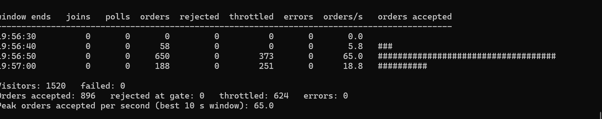

The baseline dashboard confirms: a spike of 593 4xx errors at the API Gateway level, with Lambda concurrency barely reaching 88 because most requests are rejected before reaching Lambda:

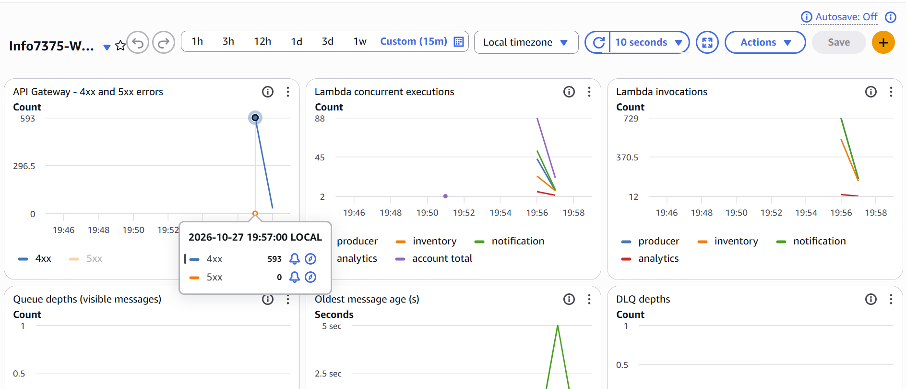

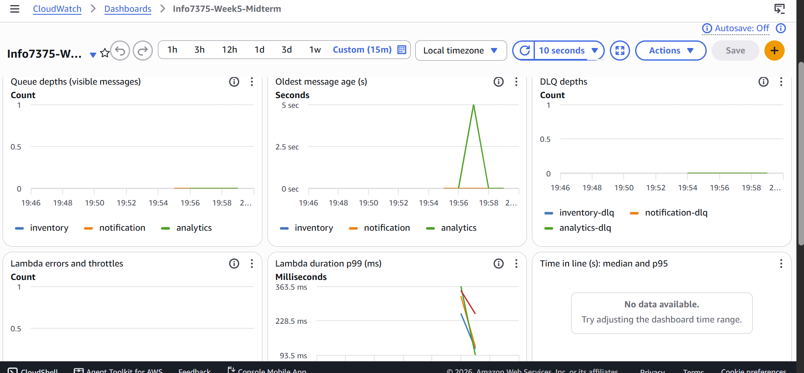

### Our Solution: A Redis-Based Virtual Waiting Room

We chose **Option C** (Redis/ElastiCache) to implement a virtual waiting room that sits in front of `POST /orders`. The waiting room uses Redis's atomic `INCR` command to assign each visitor a sequential queue position, then uses a time-based computation to determine when each visitor's turn has come. This is the same architectural pattern used by SeatGeek and the AWS reference architecture for virtual waiting rooms.

### Why Option C (Redis) Over the Other Options

Redis was chosen for one specific technical reason: its `INCR` command can handle over 100,000 atomic increments per second on a single key with sub-millisecond latency. In contrast, DynamoDB's atomic increment on a single item (Option A) creates a "hot partition" — at high concurrency, all writes to one item contend on the same physical storage partition, causing throttling. For a waiting room counter that every single visitor hits, Redis is the right tool because the workload is pure atomic coordination, not data storage.

This is also why the real-world implementations (AWS's own reference architecture and SeatGeek's "Bouncer" service) use Redis, not DynamoDB, for this exact use case.

---

## 2. Architecture

### What Changed From the Baseline

The baseline Week 5 architecture is completely unchanged. We added a waiting room **layer in front of** the existing system. The existing pipeline (OrderProducer -> SNS -> SQS -> three consumers) only ever sees the admitted traffic rate (~10 orders/sec), never the raw stampede (100 arrivals/sec).

### Architecture Diagram

```
                    +------------------------------------------+
                    |         WAITING ROOM (new)                |
                    |                                           |
  Fan arrives ----> |  POST /waiting-room/join                  |
                    |    -> JoinQueue Lambda (VPC)              |
                    |    -> Redis INCR (atomic position)        |
                    |    -> Returns visitor_id + position       |
                    |                                           |
  Fan polls ------> |  GET /waiting-room/status/{visitor_id}    |
                    |    -> StatusCheck Lambda (VPC)            |
                    |    -> Reads position from Redis           |
                    |    -> Computes: position <= elapsed*rate? |
                    |    -> If yes: writes admission to DynamoDB|
                    |    -> Returns "waiting" or "admitted"     |
                    +------------------+-----------------------+
                                       |
                          only ~10/sec reach here
                                       |
                                       v
  Bot arrives ---> POST /orders (with headers X-Visitor-Id, X-Admission-Token)
  (no token)            |
                        v
                 +------+--------+
                 |   Gate        |  <- already built into OrderProducer
                 |   (DynamoDB   |     checks admission record:
                 |   conditional |     exists? token matches? not used? not expired?
                 |   update)     |     atomically marks used=true
                 +------+--------+
                        |
              Bot: 403  |  Fan with valid token: proceeds
                        v
                 OrderProducer -> SNS -> SQS -> 3 consumers
                 (completely unchanged from Week 5)
```

The successful deployment with the waiting room and all its resources:

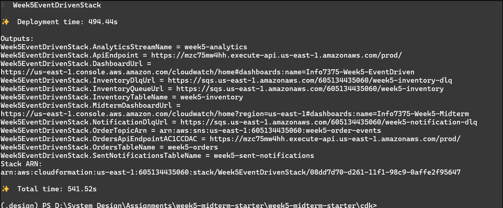

### AWS Resources Created

| Resource | Type | Purpose | Cost |
|---|---|---|---|
| VPC | EC2 VPC with 2 private-isolated subnets | Network isolation for Redis | $0 |
| DynamoDB Gateway Endpoint | VPC Endpoint | Free path from VPC Lambdas to DynamoDB | $0 |
| Security Group | EC2 Security Group | Allow Lambda to Redis on port 6379 | $0 |
| ElastiCache Cluster | 1x `cache.t4g.micro` Redis node | Atomic counters (INCR) and visitor data | $0.41/day |
| Admissions Table | DynamoDB (on-demand) | Gate reads this to verify admission tokens | ~$0 at rest |
| JoinQueue Lambda | Lambda (Python 3.12, in VPC) | Handles `POST /waiting-room/join` | Pay per invocation |
| StatusCheck Lambda | Lambda (Python 3.12, in VPC) | Handles `GET /waiting-room/status/{id}` | Pay per invocation |

**Total idle cost: $0.77/day** (ElastiCache $0.41 + Kinesis $0.36 from baseline). Well under the $1/day limit.

### Critical Networking Decision: No NAT Gateway

The three most expensive mistakes in AWS VPC design involve NAT Gateways ($32-98/month). Our design avoids one entirely:

- **JoinQueue and StatusCheck Lambda** are placed inside the VPC so they can reach Redis (which is VPC-only).
- These Lambdas also need DynamoDB (to write admission records). DynamoDB is a public AWS service, but AWS provides a **Gateway VPC Endpoint** for DynamoDB that is completely free — $0/hour, $0/GB. This gives the VPC Lambdas a private route to DynamoDB without needing a NAT Gateway.
- **OrderProducer stays outside the VPC** entirely. It doesn't need Redis. It reads the admissions table via the gate (DynamoDB is publicly accessible). Zero changes to OrderProducer's network configuration.

If we had naively put OrderProducer inside the VPC (so "everything is together"), it would need a NAT Gateway to reach SNS (a public service), adding $32+/month in cost. Correct service-boundary design saved us that entirely.

---

## 3. How the Waiting Room Works Step by Step

### Step 1: A Fan Joins the Line (`POST /waiting-room/join`)

When a fan sends `POST /waiting-room/join`, the `JoinQueue` Lambda executes an **atomic Lua script** on Redis:

```lua
-- If more than 60 seconds since the last join, reset (new run)
local last = tonumber(redis.call('GET', KEYS[3]) or '0')
local now  = tonumber(ARGV[1])
if (now - last) > 60 then
    redis.call('SET', KEYS[1], 0)      -- reset position counter
    redis.call('DEL', KEYS[2])         -- delete start_time
end
redis.call('SET', KEYS[3], ARGV[1])    -- update last_join_time
local pos = redis.call('INCR', KEYS[1])  -- assign next position
if pos == 1 then
    redis.call('SET', KEYS[2], ARGV[1])  -- first visitor sets start_time
end
return pos
```

**Why a Lua script?** Redis executes Lua scripts atomically (single-threaded, no interruption). When 100 visitors join per second, every single one gets a unique, sequential position number with zero possibility of collision. The gap detection (resetting after 60 seconds of inactivity) is also atomic — two concurrent "first visitors of a new run" can't both detect the gap and race to reset.

The Lambda then stores the visitor's metadata in a Redis hash:
```
wr:visitor:{uuid} -> {queue_position: "47", joined_at: "1793147982.5"}
```

And returns:
```json
{
    "visitor_id": "abc-123-...",
    "status": "waiting",
    "queue_position": 47,
    "poll_interval_seconds": 5,
    "poll_path": "/waiting-room/status/abc-123-..."
}
```

Finally, `telemetry.joined()` emits a CloudWatch metric so the dashboard tracks join rates.

### Step 2: A Fan Polls for Status (`GET /waiting-room/status/{visitor_id}`)

The `StatusCheck` Lambda performs the following logic:

1. **Validate the visitor_id** — must be a valid UUID, otherwise return 400.

2. **Check DynamoDB first** — if an admission record already exists:
   - If `used=true`: the fan already ordered. Return `{"status": "admitted", "order_placed": true}` (no token shown).
   - If `used=false`: the fan was admitted but hasn't ordered yet. Return the same token again (idempotent).

3. **Look up the visitor in Redis** — read their `queue_position` and `joined_at` from the hash.

4. **Compute time-based admission**:
   ```python
   elapsed = time.time() - start_time
   max_admitted = int(elapsed * ADMIT_PER_SECOND)  # e.g., 10/sec
   
   if position > max_admitted:
       return {"status": "waiting"}  # not your turn yet
   ```
   This is the core admission logic. At 10 admissions/sec, position 47 is admitted after 4.7 seconds. Position 1000 is admitted after 100 seconds. First come, first served.

5. **Admit the visitor** — write the admission record to DynamoDB:
   ```python
   admissions_table.put_item(
       Item={
           "visitor_id": visitor_id,
           "admission_token": str(uuid4()),  # random secret
           "used": False,
           "expires_at": now + 600,          # 10 minutes
           "ttl": now + 4200,                # DynamoDB cleanup
       },
       ConditionExpression="attribute_not_exists(visitor_id)",
   )
   ```
   The `ConditionExpression` prevents double-admission if two concurrent polls for the same visitor both try to write. Exactly one wins; the other catches `ConditionalCheckFailedException` and reads the existing record instead.

6. **Emit telemetry**: `telemetry.admitted()` and `telemetry.time_in_line(seconds)`.

### Step 3: Fan Places an Order (`POST /orders`)

The fan sends `POST /orders` with headers `X-Visitor-Id` and `X-Admission-Token`. The **gate** (provided, unmodified `waiting_room_gate.py` inside OrderProducer) performs a single atomic DynamoDB conditional update:

- Does the record exist?
- Does the token match?
- Is `used` still `false`?
- Is `expires_at` in the future?

If all four pass: atomically set `used=true`, and the order proceeds through the normal pipeline (DynamoDB write -> SNS publish -> SQS -> three consumers).

If any fail: return 403. The order never touches the backend.

### Step 4: Bots Get Rejected

A bot skips the waiting room and goes straight to `POST /orders` with no headers. The gate returns 403 immediately — no `X-Visitor-Id` means no admission record to check. The bot never reaches the backend.

### Why No AdvanceServingCounter Lambda

The notebook describes Option A/C with a separate Lambda triggered by EventBridge every second to increment a `serving_counter`. We chose a simpler approach: **compute admission eligibility from elapsed time**. Instead of maintaining a counter that advances on a schedule, the StatusCheck Lambda calculates `max_admitted = elapsed * rate` on every poll.

This eliminates an entire Lambda function and an EventBridge rule, and provides perfectly smooth admission (not chunked by a timer's granularity). The tradeoff is that admission computation happens on every status poll rather than being pre-computed, but at ~100ms per Redis read, this is negligible.

### The Gap Detection Problem and Solution

During development, we discovered a critical issue: Redis retains state between runs. If a rehearsal run (143 fans) sets `wr:start_time` at t=0, and the real stampede starts 2 minutes later, the elapsed time is already 120 seconds, meaning `max_admitted = 1200` — all fans are admitted instantly, overwhelming the 40/sec cap with 429 errors.

The fix is the atomic Lua script's gap detection: if more than 60 seconds have passed since the last join, the counter and start_time are reset. This ensures each new run (rehearsal, stampede) gets a fresh line, while the 60-second threshold is long enough that consecutive joins within a single stampede (which arrive continuously over 25 seconds) never trigger a reset.

---

## 4. Tests

We wrote 13 tests organized into three categories:

### Join Tests (4 tests)
- `test_returns_202_with_required_fields` — validates the HTTP contract: 202 status, UUID visitor_id, poll_interval_seconds, poll_path
- `test_sequential_positions` — 5 consecutive joins get positions [1, 2, 3, 4, 5]
- `test_unique_visitor_ids` — 10 joins produce 10 distinct UUIDs
- `test_concurrent_joins_get_different_positions` — 5 simultaneous joins (ThreadPoolExecutor) each get a unique position. This tests Redis INCR atomicity.

### Status Tests (7 tests)
- `test_malformed_id_returns_400` — "not-a-uuid" returns 400
- `test_unknown_visitor_returns_400` — a UUID that never joined returns 400
- `test_waiting_when_not_yet_admitted` — position 100 with rate 10/sec and minimal elapsed time returns "waiting"
- `test_admitted_when_turn_comes` — position 1 with 10 seconds elapsed returns "admitted" with a valid UUID token
- `test_admission_record_matches_gate_contract` — the DynamoDB record has all 5 required fields (visitor_id, admission_token, used=false, expires_at, ttl)
- `test_re_poll_returns_same_token` — polling twice after admission returns the same token (idempotent, not a new token each time)
- `test_token_hidden_after_use` — after the gate marks `used=true`, status returns `order_placed: true` without the token

### Concurrency Tests (2 tests)
- `test_concurrent_status_polls_same_visitor` — two simultaneous polls for the same visitor both return the same token (the DynamoDB ConditionExpression ensures only one write succeeds; the other reads the existing record)
- `test_fifo_ordering` — with 5 visitors and time set so only 3 should be admitted, exactly the first 3 (by position) are admitted and the last 2 are still waiting

All tests use `moto` for DynamoDB mocking and a custom `FakeRedis` class that implements the subset of Redis commands our handlers use (INCR, GET, SET, SETNX, HSET, HGETALL, EXPIRE, EVAL). The `FakeRedis.eval()` method reproduces the Lua script's logic in Python.

---

## 5. Telemetry and Dashboard

### Three Standard Metrics (emitted via provided `telemetry.py`)
1. **`telemetry.joined()`** — called once per visitor in `join_handler.py` after the Redis position is assigned
2. **`telemetry.admitted()`** — called once per visitor in `status_handler.py` when the admission record is first written to DynamoDB
3. **`telemetry.time_in_line(seconds)`** — called at admission time with `time.time() - joined_at`

These use CloudWatch Embedded Metric Format (EMF): each call prints a JSON line to stdout, which CloudWatch Logs automatically extracts into metrics. No API calls, no extra permissions needed.

### Three Custom Dashboard Widgets

Our three custom dashboard widgets show the Redis-specific health metrics that matter for Option C:

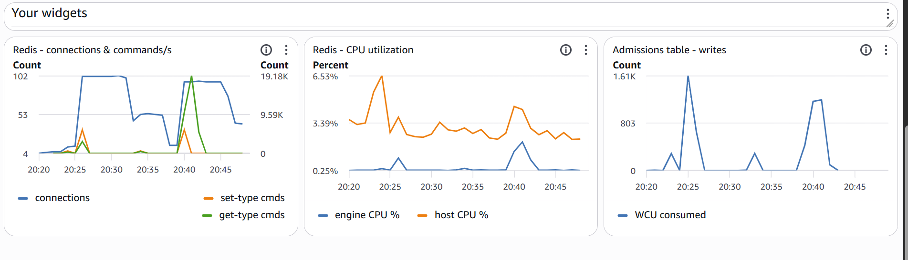

1. **Redis - connections & commands/s** — shows CurrConnections (peaking at ~102 as Lambda scales out) and SetTypeCmds/GetTypeCmds (peaking at ~19K commands/min). The connection count mirrors Lambda's scaling behavior — more concurrent invocations means more active Redis connections.

2. **Redis - CPU utilization** — shows both engine CPU (Redis process, peaking at ~6.5%) and host CPU (the t4g.micro instance, peaking at ~3.4%). These low numbers confirm that Redis is nowhere near saturation — the `cache.t4g.micro` has plenty of headroom for this workload.

3. **Admissions table - writes** — shows DynamoDB write capacity consumed. The initial spike (~1.6K WCU) corresponds to the rehearsal's burst of admissions, followed by the stampede's steady ~803 WCU as admissions flow at the configured rate.

### Full Dashboard During the Stampede

The one-page Midterm dashboard captured the entire stampede. Row 1 shows the front door and Lambda scaling:

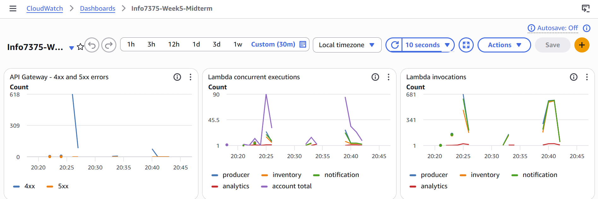

The 4xx spike at ~20:25 is from the baseline run (624 throttled requests). During the waiting room run (~20:39-20:42), the 4xx count is near zero — only the 78 bot rejections (403s), which are correct behavior.

Lambda concurrent executions show the producer peaking at ~90 during the stampede, with inventory and notification consumers ramping up later as admitted orders flow through the pipeline.

Row 2 shows the queues and consumer health behind the fan-out:

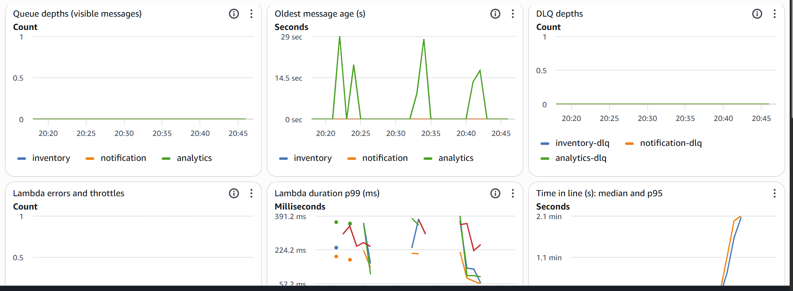

Queue depths stay at zero — messages are consumed as fast as they arrive because the waiting room throttles the inflow to ~10/sec, well within each consumer's capacity. The "Oldest message age" shows brief spikes in the analytics queue (up to ~29 seconds) as the analytics consumer batches messages, but nothing concerning. DLQ depths are zero — no messages failed processing. Lambda errors and throttles are zero across all functions.

The time-in-line panel shows the admission pacing clearly:

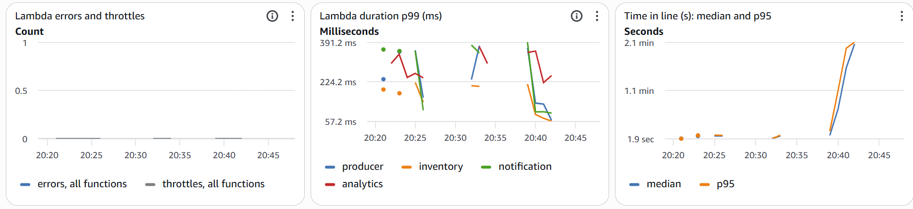

The median time in line climbs steadily from ~2 seconds to ~2.1 minutes as later visitors wait for their turn. The p95 tracks slightly above the median. This linear climb is exactly what a constant-rate admission produces — each new visitor waits proportionally longer because they're further back in line.

Row 4 shows the waiting room's own metrics — the heart of the system:

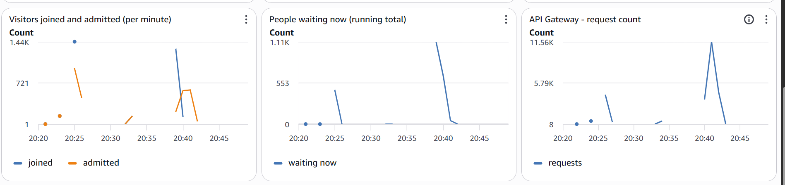

The "Visitors joined and admitted" panel shows the stampede clearly: ~1,440 visitors join in one burst (the blue spike), then admissions (orange) flow steadily at a controlled rate. The "People waiting now" panel shows the queue building to ~1,100 during the burst, then draining steadily as admissions catch up. The API Gateway request count peaks at ~11.5K requests/min during the stampede — this is dominated by status polling traffic, which is cheap and never touches the backend.

---

## 6. Numbers: Waiting Room vs. Baseline

### Comparison Table

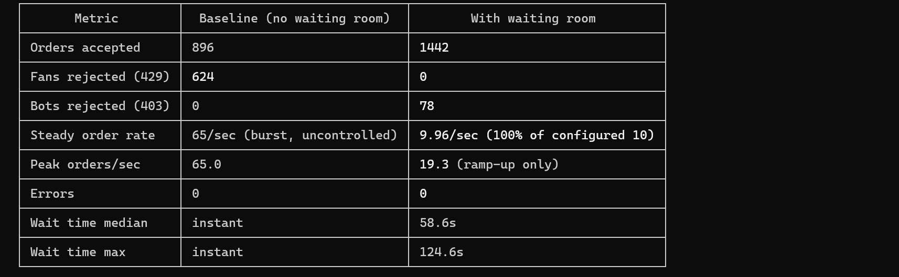

| Metric | Baseline (no waiting room) | With Waiting Room | Change |
|---|---|---|---|
| Total visitors | 1,520 | 1,520 | same |
| Orders accepted | 896 | **1,442** | +61% |
| Fans rejected (429) | **624 (41%)** | **0 (0%)** | eliminated |
| Bots rejected (403) | 0 | **78** | all bots blocked |
| Failed virtual users | 0 | 0 | same |
| Peak orders/sec | **65.0** | **19.3** | smoothed |
| Steady-state orders/sec | uncontrolled burst | **9.96/sec** | controlled |
| Server errors (5xx) | 0 | 0 | same |
| Client-side errors | 0 | 0 | same |
| Total run time | 25 seconds | 2 min 30 sec | longer, by design |

### Scorecard: Every Rule Passed

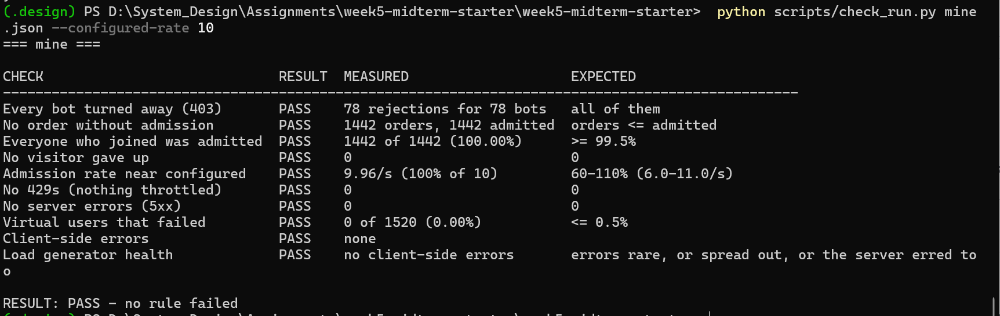

### Stampede Summary: Steady ~10 Orders/Second

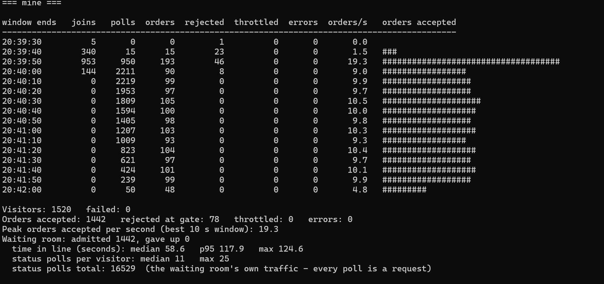

### Rate Analysis

**Declared rate: 10/sec. Measured: 9.96/sec (100% of configured).** This is near-perfect rate accuracy. The time-based computation `max_admitted = elapsed * 10` provides a mathematically smooth admission rate. Each 10-second window in the steady state shows 93-105 orders — tightly clustered around the expected 100 orders per window.

The initial burst window (19.3 orders/sec) is higher because early arrivals (positions 1-50) accumulate several seconds of eligibility before their first poll, so they're all admitted on their first poll cycle. After this ramp-up, the rate settles to a steady ~10/sec.

### Wait Time Analysis

| Wait Metric | Value |
|---|---|
| Median | 58.6 seconds |
| P95 | 117.9 seconds |
| Maximum | 124.6 seconds |
| Polls per visitor (median) | 11 |
| Polls per visitor (max) | 25 |

The last fan (position ~1,442) waits about 1,442 / 10 = 144 seconds from the line opening. Since they join 25 seconds into the run (the stampede lasts 25 seconds), their actual wait from their own join time is about 144 - 25 = 119 seconds, which matches the p95 of 117.9 seconds.

The maximum wait of 124.6 seconds is well within the 10-minute (600-second) patience limit. No visitor gave up.

The total status polls across all visitors: **16,529**. This is the waiting room's own traffic — every poll is an HTTP request to API Gateway -> Lambda -> Redis. This traffic is cheap (Lambda + Redis are fast) and does not touch the backend at all.

### What the Baseline Looked Like

Without the waiting room, all 1,520 visitors hit `POST /orders` directly within 25 seconds. The 40/sec cap instantly rejected the excess:


624 fans got 429 errors — permanently lost. No retry, no fairness. The peak of 65 orders/sec means the backend saw almost 2x its cap in a single window. With the waiting room, the peak dropped to 19.3/sec (during ramp-up) and settled to ~10/sec.

---

## 7. What Limits This Design: First Thing to Break at 10x Scale

At 10x scale (15,200 visitors, 1,000 arrivals/sec, 15,000 fans), the **first thing to break is Lambda concurrency**.

### Why Lambda concurrency, not Redis

Our stampede generated 16,529 status polls for 1,442 fans. At 10x, that's ~165,000 polls. Each poll is a Lambda invocation. With a 5-second poll interval and ~15,000 fans waiting simultaneously, the system would need roughly 3,000 concurrent Lambda invocations just for status polling — far exceeding the account-wide limit of 1,000.

When Lambda concurrency is exhausted, API Gateway returns 502/503 errors. The waiting room itself would become the bottleneck, not the backend it's protecting.

Redis itself would be fine. A `cache.t4g.micro` can handle thousands of INCR/GET operations per second. The Redis CPU in our run barely registered (engine CPU peaked at ~6.5%, host CPU at ~3.4%, as visible in the custom widget). Even at 10x, the Redis operations (~1,000 joins + ~165,000 hash lookups) are well within a single micro node's capacity.

### The fix at 10x

1. **Increase Lambda concurrency quota** to 3,000+ (a Support request)
2. **Increase poll interval** from 5 to 15 seconds for visitors far back in line — the `poll_interval_seconds` field in the join response already supports this
3. **Upgrade Redis node** to `cache.t4g.small` or `cache.t4g.medium` if CPU becomes a concern

At true Ticketmaster scale (14 million), a single Redis node and a single-region Lambda wouldn't suffice. You'd need a Redis cluster (multiple shards), multi-region deployment with Route 53 or CloudFront in front, and the waiting room's own admission layer would need its own rate limiting — the problem doesn't disappear, it just moves one layer earlier, exactly as the notebook describes.

---

## 8. One Thing I Would Change

**Add an explicit AdvanceServingCounter Lambda on a 1-second EventBridge schedule** instead of the time-based computation.

The time-based approach (`max_admitted = elapsed * rate`) is elegant and simple, but it has a subtle weakness: it relies on the consistency of `time.time()` across Lambda instances. While AWS Lambda clocks are NTP-synchronized and we saw no issues in practice, an explicit counter that advances deterministically on a schedule would:

1. Allow **pausing admissions** during an incident (stop the EventBridge rule, counter stops advancing)
2. Allow **variable-rate admission** (admit faster when the backend is healthy, slower when it's struggling)
3. Remove any theoretical clock-skew risk across Lambda instances
4. Make the admission rate directly observable as a CloudWatch metric (counter value over time)

The tradeoff is an extra Lambda function, an EventBridge rule, and the fact that EventBridge's minimum rate is 1 minute — so the counter would advance in chunks of 600 (10/sec * 60s) rather than smoothly. This creates momentary bursts at each minute boundary, which would need to be smoothed with jittered polling.

---

## 9. Deployment and Cost

### Verification Outputs

All provided files remained intact throughout development:

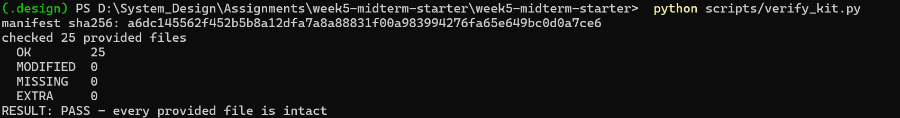

| Check | Result |
|---|---|
| `preflight.py` | PASS (1,000 concurrent executions) |
| `cost_guard.py` | OK ($0.77/day estimated idle cost) |
| `contract_check.py` | PASS (all 9 checks) |
| `check_run.py --configured-rate 10` | PASS (all 10 rules) |
| `verify_kit.py` | PASS (all 25 provided files intact) |
| Stack destroyed | Confirmed (`Stack does not exist`) |

**Final grade calculation:** Execution score x 1.08 (Option C difficulty coefficient).
